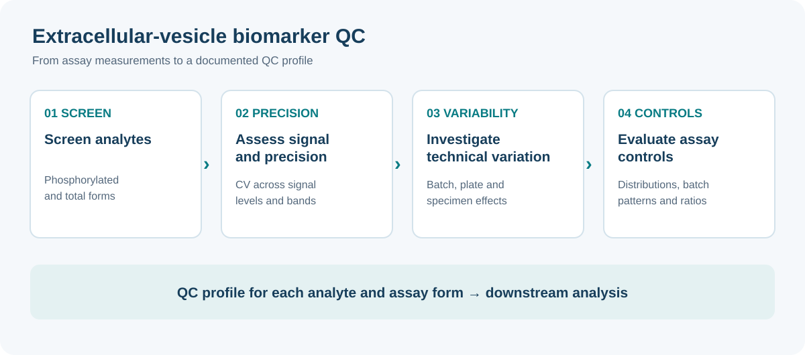

Ongoing collaborative researchDPPOS

## Overview

At the GWU Biostatistics Center, I work with clinicians on longitudinal proteomic and extracellular-vesicle (EV) biomarker research in the Diabetes Prevention Program Outcomes Study (DPPOS). This work includes analysis planning, power calculations, biomarker quality control, and reproducible analytical tools.

## Study context

DPPOS follows participants from the Diabetes Prevention Program to investigate the long-term effects of diabetes prevention. Its current research includes questions about cognitive aging, Alzheimer's disease, and related dementias. Learn more on the [official DPPOS study website](https://dppos.bsc.gwu.edu/web/dppos/welcome).

## Research questions

One EV project examines whether markers of insulin signaling are associated with Alzheimer's disease-related biomarkers and whether dysglycemia modifies that association. The research framework compares neuron-derived EVs with total EVs and considers markers including pTau217, total tau, Aβ42, Aβ40, and the pTau217/Aβ42 ratio. These are research questions rather than established findings from this project.

The shared cohort workflow describes 1,690 participants consenting to DPPOS-4, 1,562 completing the first DPPOS-4 visit, and an analytic cohort of 460 with available exosome biomarker measurements. These counts describe the supplied workflow and may change as the study progresses.

## My contribution

- Co-lead statistical analysis plan development and power analyses for longitudinal proteomic biomarker studies, collaborating with clinicians on quality control and downstream analyses.
- Develop quality-control procedures for EV biomarkers and assess how QC decisions affect analyses of insulin signaling and associations with Alzheimer's disease and related dementias.
- Build reproducible R and Shiny workflows for biomarker portfolios.

## Analytical workflow

The EV quality-control workflow screens phosphorylated and total analytes, assesses precision across signal levels, examines technical variability by batch and plate, and evaluates assay controls. It summarizes the resulting QC profile for each analyte and assay form, providing a foundation for downstream analyses and sensitivity assessments.

## Data access and limitations

This is ongoing collaborative research. The materials shared here describe the study framework and workflow; they do not present participant-level data or project-specific analytical findings. DPPOS resources are available to qualified researchers by request through the [NIDDK Central Repository](https://repository.niddk.nih.gov/studies/dppos/).

## Outputs

<a class="output-link-card" href="https://dppos.bsc.gwu.edu/web/dppos/welcome">
<strong>Official DPPOS study website</strong>
Study background and resources
</a>

