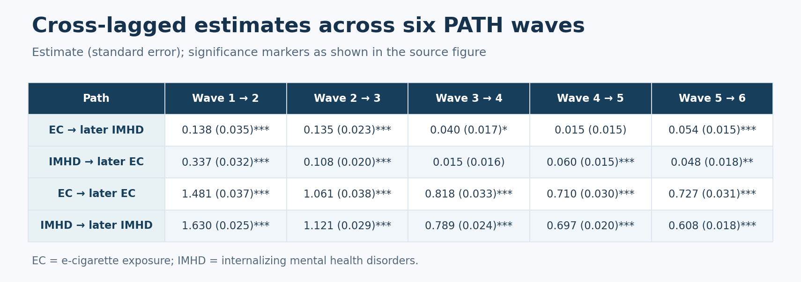

Longitudinal research

## Overview

This project used longitudinal Population Assessment of Tobacco and Health (PATH) data to study the relationship between e-cigarette exposure and internalizing mental health disorders (IMHD) over time.

## Research problem

E-cigarette exposure and mental health can change together over time. A longitudinal approach can examine how measurements at one wave relate to measurements at the next while accounting for the persistence of each measure.

## Why it matters

Understanding the timing and direction of associations can inform further research on tobacco exposure and mental health. Associations in this observational analysis do not by themselves establish a causal effect.

## My contribution

As a biostatistical consultant at the NYU Biostatistical Collaboration and Consultation Core, I built the longitudinal cross-lagged model for this project.

## Data and study design

The study included 13,660 adults with at least two waves of e-cigarette and mental health assessment data across six PATH waves (2013–2021). Current e-cigarette use and internalizing problems measured using the GAIN-SS were assessed over time. The presentation also examines demographic characteristics and other substance use.

## Statistical methods

- Descriptive trajectories and population-average logistic regression
- Random-intercept logistic regression to examine demographic and substance-use associations
- Longitudinal cross-lagged modeling across consecutive waves
- Paths within each measure over time and between the two measures at adjacent waves

## Results and practical contribution

The figure below reorganizes the estimates shown in the supplied results diagram. Cross-lagged estimates varied across waves; the figure preserves the reported standard errors and significance markers. The presentation describes these findings as preliminary and identifies an adjusted cross-lagged model as a next step. It does not define the significance thresholds in the results figure.

## Limitations

The analysis is observational, so the reported associations should not be interpreted as causal effects. The cross-lagged results are preliminary; the presentation identifies covariate adjustment and further subgroup analyses as next steps. The significance thresholds are not defined in the figure.

## Outputs

<a class="output-link-card" href="../assets/docs/PATH_EC_IMHD_Slides.pdf">
<strong>Original presentation slides</strong>
GPH Tobacco Research Lab · May 2024 · PDF
</a>

